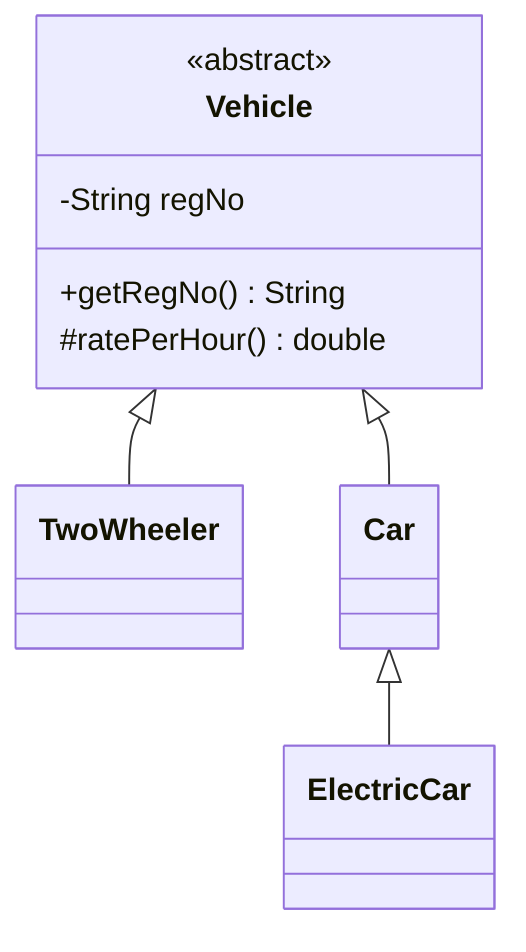

# Task 6 – UML Class Diagram

Add a UML class diagram showing `Vehicle` as an abstract superclass and the vehicle subclasses. Show inheritance arrows and important fields/methods.

You may use Mermaid:

